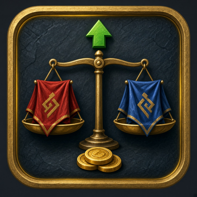

<p align="center"></p>

# NeutralFlip (WoW: Forever) v0.1.0

> [!WARNING]
> **Untested in-game. Use at your own risk.** WoW: Forever launches Nov 4 2026, so none of this has run in the real client yet.
> - API calls are checked against Blizzard's UI source (Gethe/wow-ui-source `forever`, 1.60.1 build 70374), luacheck, and 38 mock-client tests.
> - The neutral-AH map IDs (1434/1446/1452) are Classic-era IDs and haven't been confirmed for Forever. If detection is wrong, `/nflip here neutral|faction` fixes it for that spot.
> - The 5% faction / 15% neutral cuts come from [AHledger](https://ahledger.com/wow-forever/auction-house), not Blizzard. Change them with `/nflip cut`.

In WoW: Forever each faction has its own auction house. The goblin auctioneers in **Booty Bay, Gadgetzan and Everlook** run the only cross-faction market. Prices there often differ a lot from your faction's house (see [auctionhouse.fyi Horde vs Alliance](https://auctionhouse.fyi/horde-vs-alliance)).

NeutralFlip keeps **separate prices for your faction AH and the neutral AH**. It then tells you which items are worth carrying across, after the cut:

```
1. Mageroyal: BUY at Alliance AH at 1s or less (x30) -> LIST at neutral AH at 18s 99c -> +15s 14c each, about 4g 54s total [data 2h old, deposit at risk 2s 25c]
```

- **Both directions:** faction to neutral, and neutral to faction.
- **Net of the cut:** each listing is priced 1c under the lowest one you saw, and the profit shown is after the 5% or 15% cut.
- **Filters:** a flip only shows if its profit is at least 20% of the buy price and at least 50c a unit. Prices older than 24 hours are ignored.
- **Quantity:** capped at what's listed at the lowest price and at what the other house lists.
- **Deposit at risk:** you get the deposit back if the item sells. The rate is measured with `C_AuctionHouse.CalculateCommodityDeposit` the first time you open each kind of AH.
- **Thin-market flag:** shown when the gap is 20x or more, because that's usually a troll listing.
- **Tooltip:** adds one or two lines: both prices, plus the flip if there is one.

**It never buys, posts or clicks anything.** It only records prices the AH already shows you, from your own searches or a full scan you start yourself. It also picks up full scans started by PriceLog or MatTooltip. You make every purchase and post.

## Download
- **CurseForge:** https://www.curseforge.com/wow/addons/neutralflip (first release coming at launch, Nov 4). Author: [MasterRed92](https://www.curseforge.com/members/masterred92/projects).
- **Wago Addons:** https://addons.wago.io/addons/neutralflip (first release coming at launch, Nov 4).
- **GitHub:** [Releases](https://github.com/masterred92/NeutralFlip/releases) (coming with the first tagged release) · [Issues](https://github.com/masterred92/NeutralFlip/issues)
- **Companion addons** (optional, they share AH scans): [PriceLog](https://github.com/masterred92/PriceLog) · [MatTooltip](https://github.com/masterred92/MatTooltip) · [GoldPerSpot](https://github.com/masterred92/GoldPerSpot)

## Commands
`/nflip` lists flips (copyable) · `scan` (at an open AH, out of combat, about every 15 min) · `here neutral|faction|auto` · `status` · `cut faction 0.05` · `cut neutral 0.15` · `age 24` · `margin 0.2` · `tooltip` · `report` · `wipe`

## Install
Put the `NeutralFlip` folder in `World of Warcraft\_forever_\Interface\AddOns\` and restart the game or `/reload`.

## In-game test checklist (launch day)
1. NeutralFlip appears in the AddOns list and isn't marked "out of date". `/nflip` opens the window, which says "Nothing worth carrying yet".
2. **Faction AH** (e.g. Stormwind or Orgrimmar): chat says "this is the Alliance/Horde auction house". It must NOT say neutral.
3. Search for a herb, e.g. Peacebloom. `/nflip status` shows prices for `<realm>-<faction>`.
4. Wait about 2 seconds with something sellable in your bags. `/nflip status` should show a learned faction deposit rate, not "?".
5. **Neutral AH** (Booty Bay, Gadgetzan or Everlook): chat says "this is the neutral auction house". If it doesn't, type `/nflip here neutral` and note the zone/subzone from `/nflip report` for a bug report.
6. Search the same herb there. `/nflip status` should show a separate `<realm>-Neutral` bucket, and the faction price must be unchanged.
7. Check that the neutral deposit rate differs from the faction one, which confirms the deposit cross-check works. Also check whether the 15% cut matches a real sale mail, and fix it with `/nflip cut neutral` if not.
8. `/nflip` lists flips with sensible numbers. Spot-check one by hand: listAt × (1 − cut) − buy.
9. Hover the item. The NeutralFlip line shows both prices. Polestar, MatTooltip and other tooltip addons' lines must still show.
10. Optional: `/nflip scan` at an AH reports "saved N prices" within about a minute, with no lag spike or Lua error. Run it again straight away and it should refuse with a cooldown message.
11. Hover items during combat: no errors, no "action blocked" messages.
12. `/reload` keeps everything. `/nflip report` opens a copyable window.
13. In the AddOns list (character select or Esc > AddOns), NeutralFlip shows its icon. If it shows a blank or green square, report it; the addon still works.

## Licence
MIT. Written from scratch; no code copied from other addons.

## Development
`tests/run.sh [path-to-wow-ui-source-forever]` runs `luac -p`, luacheck, the mock-client tests and (with a path) the API check against Blizzard's UI source. GitHub Actions runs the same on every push. Releases are packaged by [BigWigsMods/packager](https://github.com/BigWigsMods/packager) only when a `v*` tag is pushed.
